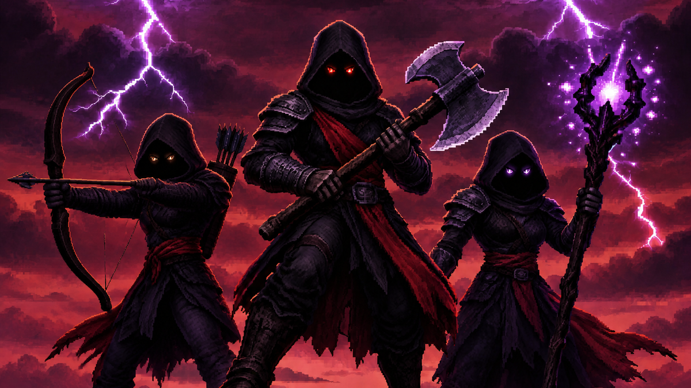

<p align="center">
  
</p>

<h1 align="center">Renegades</h1>

<p align="center">
  
  
  
</p>

⚔️ **Adventurers who chose the wrong side.** Renegades is a NeoForge mod for Minecraft 1.21.1 (Java 21) that adds rare
hostile adventurers of ten RPG classes: warriors, rogues, paladins, archers, wizards and priests, plus elemental
wizards, berserkers, bards and forcemasters with their class mods. They wear real class gear, fight with telegraphed
attacks and spells, travel in small groups, and drop what they wore when you beat them.

> **Client & Server required.** Renegades adds entities with their own models and animations, so it has to be
> installed on the server and on every client.
>
> **GeckoLib required, everything else optional.** Without other mods, the six original classes spawn with vanilla
> gear and use a built-in look for their spells. Spell Power, Spell Engine, Armor Model API, Apotheosis, Dynamic
> Difficulty and MineColonies are picked up automatically when installed.
>
> **Class mods unlock their renegades.** With the RPG Series class mods, renegades wear their class sets; the
> Elemental Wizard, Berserker, Bard and Forcemaster only exist with their own class mod.

Full documentation: **[Renegades wiki](https://github.com/Drehverschluss/Renegades/wiki)**.

## Screenshots

<!-- Screenshots will be added later. -->

## How it works

Renegades have their **own spawn timer** per player, independent of the vanilla mob cap: every minute each player gets
one attempt with a small chance (about 1.8 spawns per hour by default). A successful attempt finds a free spot 24–64
blocks away, picks a **spawn group** from data (e.g. a warrior leading a priest) whose leader may spawn in that biome,
and spawns it.

Each renegade rolls its **gear from equipment pools** on spawn: vanilla gear by distance from the world spawn, or the
class sets of the installed RPG mods in three tiers. Very rarely, one piece is replaced by a unique weapon. In combat,
a **class AI** takes over: telegraphed melee swings, ranged shots, spells, heals and support abilities, with windups you
can read and react to. When a player kills a renegade, its **gear drops** at 25–75 % durability.

Everything a pack would want to change – gear, groups, unique items, spell looks, biomes per class – is datapack data.

## Installation

1. Install NeoForge `21.1` for Minecraft `1.21.1` and GeckoLib `4.9.2` or newer.
2. Put `renegades-0.1.0.jar` into the `mods` folder of the **server and of every client**.
3. On a dedicated server, set `allow-flight=true` in `server.properties` (knockbacks and lifts can otherwise get
   players kicked for flying; Renegades logs a warning when it is `false`).
4. Optional: install any of the mods below; Renegades picks them up automatically.

| Mod | Tested version | Needed |
|---|---|---|
| GeckoLib | `4.9.2` | **required** |
| Armor Model API | `1.1.0+1.21.1` | optional (RPG armor rendered on renegades) |
| Spell Power | `1.6.0+1.21.1` | optional (spell power from gear for casters) |
| Spell Engine | `1.10.9+1.21.1` | optional (spell looks, evasion, status effects) |
| Apotheosis (+ Placebo, Apothic Attributes) | `1.21.1-8.9.0` | optional (elite renegades) |
| Dynamic Difficulty | `1.3.8+1.21.1` | optional (mob levels for gear conditions) |
| MineColonies | `1.1.1403-1.21.1` | optional (no spawns in colonies) |
| Rogues & Warriors, Paladins & Priests, Wizards, Archers | `3.1.3+1.21.1` | optional (class gear) |
| Archers Expansion | `2.2.1+1.21.1` | optional (more archer sets) |
| Elemental Wizards RPG | `3.2.2+1.21.1` | optional (Elemental Wizard class) |
| Berserker RPG | `3.2.0+1.21.1` | optional (Berserker class) |
| Bards RPG | `1.2.0-1.21.1` | optional (Bard class) |
| Forcemaster RPG | `3.2.0+1.21.1` | optional (Forcemaster class) |
| Arsenal | `1.5.0+1.21.1` | optional (unique weapons) |

All integrations are `compileOnly` at build time or only referenced by id in data, and only used when the mod is
installed. Without them, the corresponding feature is simply not there.

## What it does

### The classes

| Class | Role | Needs |
|---|---|---|
| Warrior | Heavy sweeps, a dash into a rising cut, and a parry with a counter-strike. | – |
| Rogue | Stalks invisibly, throws knives, ambushes from the side and dodges heavy hits. | – |
| Paladin | Slow and heavy: slam, whirlwind spin, a leap with a ground impact, and a shield brace. | – |
| Archer | Keeps its distance with aimed shots, volleys and traps, and repositions for a clear view. | – |
| Wizard | Fire, frost or arcane bolts, a homing volley and a nova against close targets. | – |
| Priest | Heals and protects its group from behind; interrupt its heals to win. | – |
| Elemental Wizard | Aqua, terra or wind control caster with heals, roots, knock-ups and slows. | Elemental Wizards RPG |
| Berserker | Presses forward, gets stronger as it loses health, and leaps with a guillotine blow. | Berserker RPG |
| Bard | Songs that buff its allies, mockery and crescendo against enemies. | Bards RPG |
| Forcemaster | Fist combos that charge up into one huge, announced blow. | Forcemaster RPG |

More: [Wiki → Classes](https://github.com/Drehverschluss/Renegades/wiki/Classes)

### Combat AI

Every attack has a windup, an active window and a recovery; damage is only dealt when the weapon actually swings
through its target, needs line of sight and can be blocked with a shield. Cooldowns are shortened a bit at random and
somewhat more in groups. Renegades never step into lava, fire or off deep drops, never hurt each other, and leap or
pull only to safe spots. Spells are magic damage; shields block spell bolts but not areas.

More: [Wiki → Classes](https://github.com/Drehverschluss/Renegades/wiki/Classes#how-renegades-fight)

### Gear and drops

Gear comes from datapack equipment pools: vanilla gear by distance from the world spawn (in all dimensions), or the
class sets in three tiers (up to 1500 blocks, 1500–4000 blocks and the Nether, beyond 4000 blocks and the End). With
Dynamic Difficulty, pools can also depend on the mob level. Gear drops when a player kills the renegade, with 25–75 %
durability. With Arsenal, about 1 in 400 renegades with tier 2-3 gear carries a unique weapon.

More: [Wiki → Equipment and drops](https://github.com/Drehverschluss/Renegades/wiki/Equipment-and-Drops)

### Elites

With Apotheosis, renegades can be elites: instead of a random affix item, their own class gear gets affixes and a
rarity, shown as a colored title ("Rare Warrior Renegade"). An optional chance gives a whole elite set.

More: [Wiki → Elites (Apotheosis)](https://github.com/Drehverschluss/Renegades/wiki/Elites-Apotheosis)

### Spell looks

With Spell Engine, abilities can show the particles, sounds and projectile models of the class mods' spells. Only the
look changes; damage, targets, areas and cooldowns stay the same.

More: [Wiki → Spell looks](https://github.com/Drehverschluss/Renegades/wiki/Spell-Looks-Spell-Engine)

### Spawns and groups

Groups such as a warrior with a priest or a paladin with an archer fight together: attack one, and the others within
32 blocks join in. Which biomes a class may spawn in is a biome tag per class; MineColonies colonies stay free of
natural spawns.

More: [Wiki → Spawns and groups](https://github.com/Drehverschluss/Renegades/wiki/Spawns-and-Groups)

## Configuration

Server config `config/renegades-server.toml` (per world: `<world>/serverconfig/renegades-server.toml`):

| Section | Option | Meaning |
|---|---|---|
| `spawns` | `spawnIntervalSeconds` / `spawnChance` | One attempt per player every 60 s with chance 0.03 (about 1.8 spawns per hour and player) |
| `spawns` | `minDistance` / `maxDistance` | Spawn distance from the player (default 24–64 blocks) |
| `spawns` | `maxNearby` / `capRadius` | No spawn if 3 renegades are within 128 blocks |
| `spawns` | `persistentNaturalSpawns` | Renegades from natural spawns, eggs and commands never despawn (default `true`) |
| `drops` | `armorDropChance` / `weaponDropChance` | Chance for each piece to drop (default `1.0`) |
| `drops` | `dropDurabilityMin` / `dropDurabilityMax` | Durability of dropped gear (default 25–75 %) |
| `drops` | `rareItemChanceMultiplier` | Multiplies the chance of unique items (default `1.0`) |
| `strength` | `healthMultiplier` / `damageMultiplier` | Multiply the base health and damage of all renegades (default `1.0`) |
| `combat` | `enableParry`, `enableDodge`, `enableStealth`, ... | Switch single class abilities off |
| `combat` | `healingMultiplier` | Multiplies all healing by renegades (default `1.0`) |
| `visuals` | `casterVisuals` | `auto` (Spell Engine looks if available) or `builtin` |
| `elite` | `fullSetEliteChance` | Chance for a whole elite set with Apotheosis (default `0.0`) |

All options: [Wiki → Configuration](https://github.com/Drehverschluss/Renegades/wiki/Configuration). Debug commands
(`/renegades nearby`, `spawngroup`, `reequip`, `stats`, ...): [Wiki → Commands](https://github.com/Drehverschluss/Renegades/wiki/Commands).

## Data-driven customization

Everything below can be changed with a datapack; `/reload` applies it.

| Path | Content |
|---|---|
| `data/<ns>/renegades/equipment_pools/` | What each class wears: entries with weights, conditions (dimension, distance, height, mob level), items, tags, enchantments and variants |
| `data/<ns>/renegades/spawn_groups/` | Which groups spawn: leader, weight, conditions, members |
| `data/<ns>/renegades/rare_items/` | Very rare special items per class and slot, with chance and the piece they replace |
| `data/<ns>/renegades/caster_visuals/` | Which Spell Engine spell lends its look to which ability |
| `data/renegades/loot_table/entities/<class>` | Regular loot tables (empty by default) |
| `#renegades:spawns/<class>` (biome tag) | Biomes a class may spawn in |
| `#renegades:rare_replace/*` (item tags) | Tier 2-3 weapons the bundled uniques replace |
| `#renegades:magic`, `#renegades:spell_projectile` (damage type tags) | Renegade spell damage types, added to `c:is_magic`, `neoforge:is_magic` and others |

Formats, fields and examples: [Wiki → Datapack reference](https://github.com/Drehverschluss/Renegades/wiki/Datapack-Reference).

## Mod compatibility

- **GeckoLib**: models and animations (required).
- **Armor Model API**: RPG Series armor that uses it is rendered on renegades like on players.
- **Spell Power**: casters use the spell power of their school from their gear, with critical strikes and resistances.
- **Spell Engine**: spell looks for abilities, the evasion chance on armor, and its status effects (e.g. Bleed).
- **Apotheosis**: elite renegades with affixed class gear; its magic and lightning reductions apply to renegade spells.
- **Dynamic Difficulty**: mob levels for equipment pool conditions; its level scaling applies on top.
- **MineColonies**: no natural spawns inside colonies.
- **RPG Series class mods and Arsenal**: class gear, four extra classes and unique weapons, referenced by id only.

Details: [Wiki → Compatibility](https://github.com/Drehverschluss/Renegades/wiki/Compatibility).

## Project layout

| Package | Content |
|---|---|
| `com.drehverschluss.renegades` | `Renegades` (common entry point) and `RenegadesClient` (client entry point) |
| `entity` | The renegade entities, class variants, class availability (`RenegadeClasses`), archer trap, AI goals |
| `combat` | Combat actions, action runner, swing execution, ground locomotion, profiler |
| `combat.brain` | Brain base class, stimulus, cooldowns and one brain per class |
| `combat.geometry` | Attack volumes, swing paths and hit geometry |
| `magic` | Ability specs, deliveries, impacts, magic backends, spell projectile and cloud |
| `equipment` | Equipment pools and rare items: loaders, parser, conditions, selection |
| `group` | Spawn timer, spawn groups and group behavior, spawn statistics |
| `visual` | caster_visuals loader and lookup |
| `level` | Mob level providers |
| `config` | `RenegadesConfig` (server config) |
| `command` | `/renegades` debug commands |
| `registry` | Entity types, spawn eggs |
| `client` | Model, renderers and render layers |
| `compat.*` | Optional integrations (Apotheosis, Armor Model API, Dynamic Difficulty, MineColonies, Spell Engine, Spell Power); only loaded when the mod is installed |

## Development

Requires Java 21.

- The optional mods are compiled against from the Modrinth Maven (`maven.modrinth:*`), the GeckoLib, Muon (Dynamic
  Difficulty), LDTTeam (MineColonies) and Shadows of Fire (Apotheosis) Mavens. No local jars are needed to build.
- For the dev runs, every jar in `libs/test/` (git-ignored) is added via `localRuntime`, so `runClient` and
  `runServer` behave like the target modpack. Put the mod jars you want to test with there.

```
./gradlew build        # jar in build/libs
./gradlew runClient    # dev client (game directory run/)
./gradlew runServer    # dev dedicated server (game directory run/, accept the EULA on first start)
```

### Testing

1. `runClient`, create a world, spawn each class with its spawn egg and let it fight you: windups, hits, blocking with
   a shield, its special abilities.
2. `/renegades spawngroup renegades:warrior_priest`, hurt the warrior and watch the priest heal it; interrupt a heal.
3. `/renegades nearby` and `/renegades stats`: combat state, group, spawn attempts.
4. Kill renegades and check the drops (25–75 % durability, only on player kills).
5. Edit an equipment pool or spawn group in a datapack, `/reload`, and `/renegades reequip` or `spawngroup`.
6. With the optional mods in `libs/test/`: class gear in three tiers, the four extra classes, spell looks
   (`/renegades castervisuals`), unique weapons (`/renegades rareitems`), elites (`/renegades spawnelite`).
7. Remove the optional jars from `libs/test/`: client and server still start, the six original classes work with
   vanilla gear, and the other four report "not available".
8. `runServer` and connect with `runClient` (multiplayer, `localhost`); fight a renegade of each class without being
   kicked.

## License and credits

MIT, see [LICENSE](LICENSE). Full credits and licenses: [CREDITS.md](CREDITS.md).

- The model, the animations, the combat and the magic system are based on
  [ANARCHY – RPG Minibosses](https://github.com/cleannrooster/rpg-minibosses) by cleannrooster (CC0-1.0); the trap
  model, animation and texture are taken from it.
- The classes mirror the classes of the RPG Series mods (Wizards, Paladins & Priests, Rogues & Warriors, Archers,
  Arsenal by Daedelus; Archers Expansion, Elemental Wizards RPG, Berserker RPG, Bards RPG, Forcemaster RPG by Fichte).
  Renegades contains nothing from them and only refers to their ids.
- Renegades is an unofficial companion and not affiliated with any of these mods.
- Bug reports and suggestions: [issue tracker](https://github.com/Drehverschluss/Renegades/issues).
